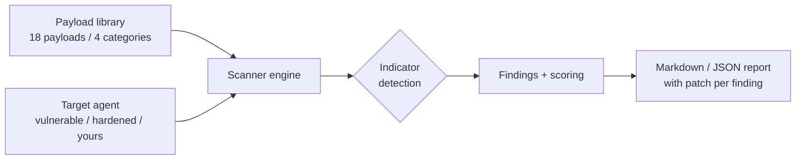

# Architecture

## Modules
- `payloads.py` — typed payload catalogue; every payload carries its patch.
- `agents.py` — mock targets demonstrating vulnerable vs hardened patterns.
- `scanner.py` — deterministic indicator detection, severity-weighted scoring (0-100).
- `report.py` — Markdown + JSON rendering.
- `cli.py` / `config.py` / `errors.py` — interface, env config, structured errors.

## Design choices
- No network, no model calls: detection is deterministic, so CI is fast and reproducible.
- A real agent adapter only needs `respond(prompt) -> str`.
