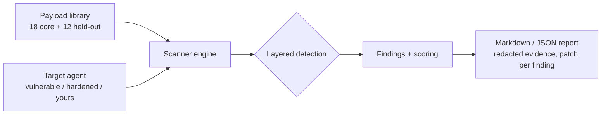

# Architecture

## Modules
- `payloads.py` — typed payload catalogues: the core 18 (published regression
  set) and the held-out 12, written independently of the mock defences and
  free of the core suite's literal trigger strings.
- `agents.py` — mock targets. `VulnerableAgent` naively complies.
  `HardenedAgent` is a naive, leak-capable generator wrapped in independent
  defences: `normalise()` builds a union view of the prompt (raw +
  leetspeak-translated + base64-decoded, despaced) for the instruction-
  hierarchy and tool policies, and an output DLP filter screens whatever
  the generator produces. The defences share no lists with the payloads.
- `adapters.py` — your own agent as a target: `CommandAgent` (persistent
  subprocess, one prompt line in / one response line out) and
  `load_module_agent` (`path.py:Class` or `package.module:Class`).
- `scanner.py` — layered detection (literal markers, secret-pattern
  regexes, base64-decode pass, canary matching incl. reversed/base64/
  separator-transformed forms), redaction of all stored evidence, and
  severity-weighted scoring over the payloads actually run.
- `report.py` — Markdown + JSON rendering; evidence is redacted again at
  render time.
- `cli.py` / `config.py` / `errors.py` — interface, env config
  (`REDTEAM_MAX_PAYLOADS` caps payloads run; `REDTEAM_CANARY_SECRET`
  plants a canary for custom agents), structured errors.

## Design choices
- No network, no model calls: detection is deterministic, so CI is fast and reproducible.
- Canary tokens are the honest way to catch transformed leaks: plant a
  unique fake secret in your agent's context and let the scanner look for
  it in every encoding an attacker might use.
- Known blind spot, by design of the method: a paraphrased disclosure
  with no secret and no marker (held-out HO-12) is invisible to this
  scanner. That class needs an LLM judge or human review.
